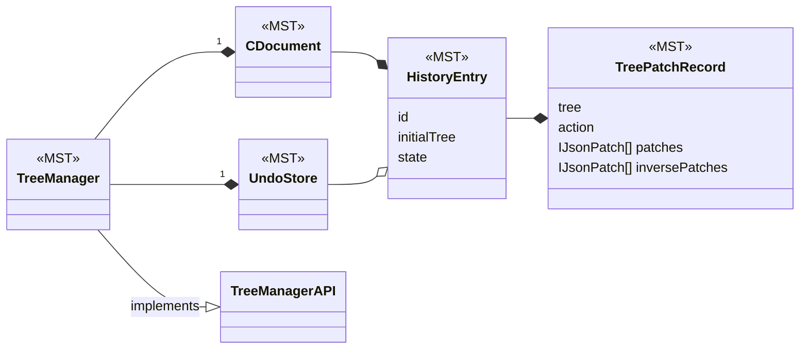
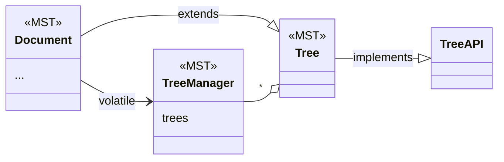
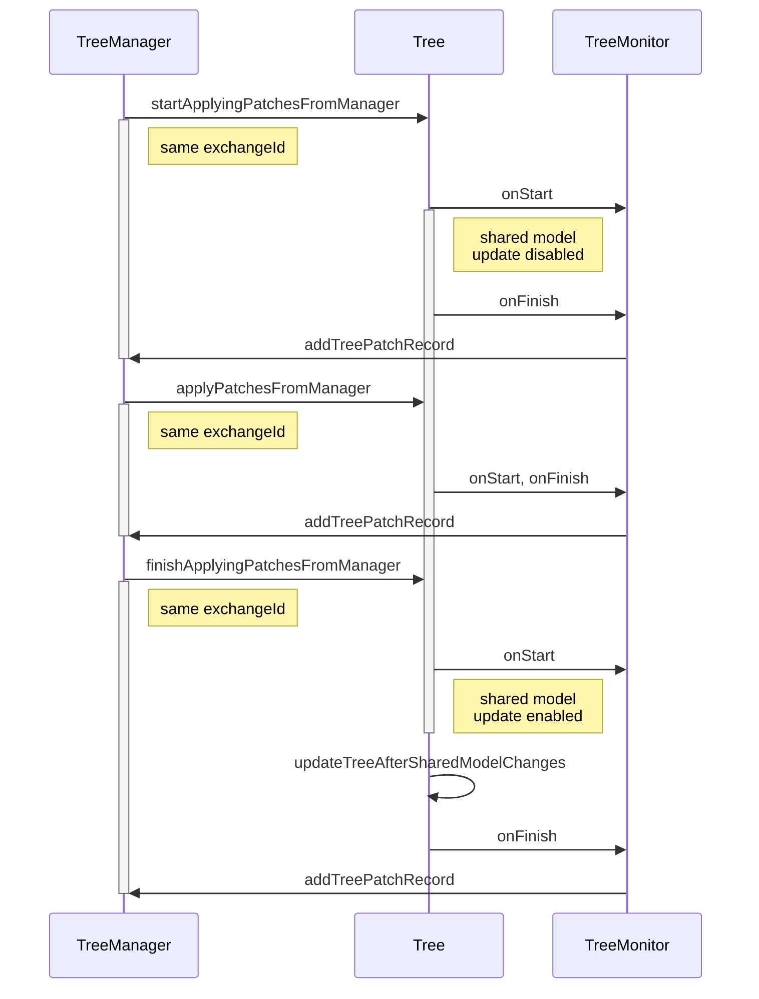
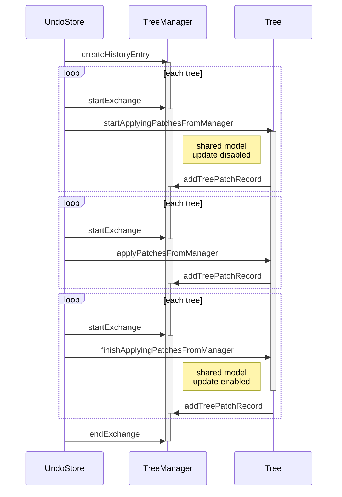
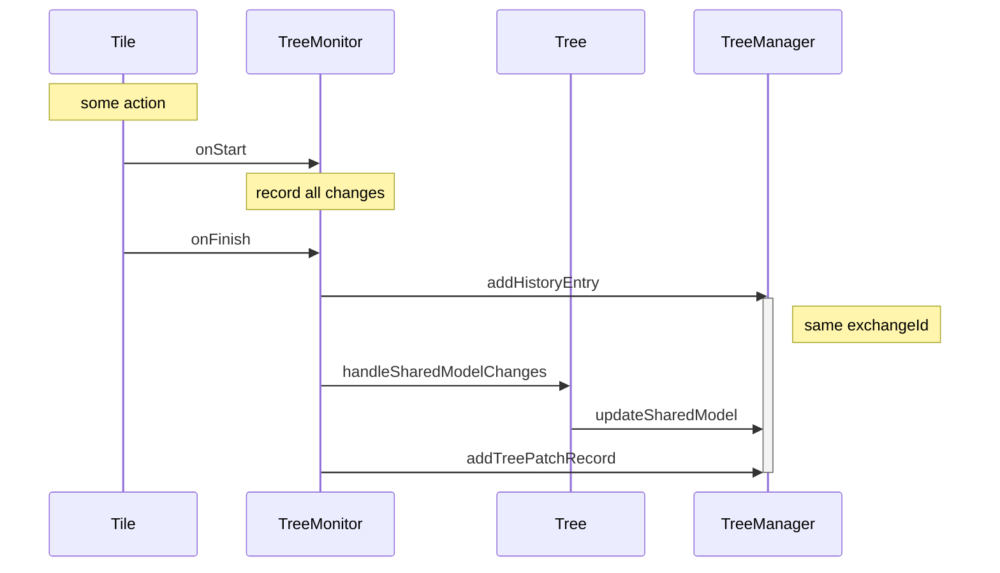
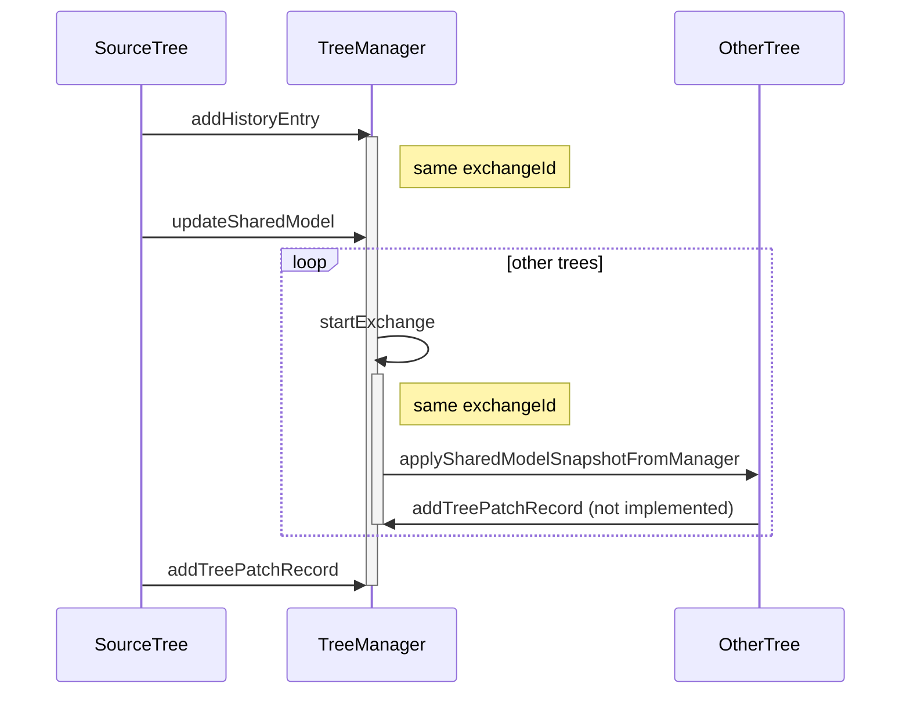

# History Framework

The history framework in CLUE is used for recording changes to documents to support undo/redo and time traveling.

The framework is based on MobX State Tree (MST). It is intended to support iframe based tile implementations. With iframe based tiles there will be multiple MST trees that need to coordinate with each other. However, we do not currently have any iframe tiles, so this capability of the system hasn't been tested yet.

The main parts of the system are:
- `TreeAPI`: this is the interface used by the TreeManager to work with the trees. It is intended to work over postMessage. Its methods are well documented.
- `TreeManagerAPI`: this is the interface used by trees to work with the TreeManager. It is intended to work over postMessage so trees in iframes can communicate with the TreeManager in the host page. Its methods are well documented.

- `TreePatchRecord`(MST): This is set of patches for a single tree. It represents what the MST action tracking middleware returns (action, patches, inversePatches)
- `HistoryEntry`(MST): This is a container of TreePatchRecords. It represents the full action which could be modifying multiple trees. It also keeps track of whether there are outstanding tree patch records that haven't been recorded yet.
- `CDocument`(MST): (change document) This has the list of history entries. It can be serialized independently to record the history of changes to the document.
- `UndoStore`(MST): This has a list of references to history entries as well as the index of the current entry that has been undone.  It would normally not be serialized itself. It uses references so we aren't keeping 2 copies of each history entry. It has actions to apply the undo and redo by applying patches to the affected trees.
- `TreeManager`(MST): This contains a CDocument and an UndoStore. It also tracks the set of trees. It implements the TreeManagerAPI.

- `Document`(MST): this creates the TreeManager in afterCreate, and stores it in its volatile prop.  It sets up the tree monitor with the Document, and TreeManagerAPI. It also adds itself as the main document of the TreeManager. The main document is added as a tree to the TreeManager's array of trees. This is the main entry point to the history system. `Document` is also the MST object that is serialized as the CLUE user document. It is not great that the Document is a tree and also initializes the TreeManager which is managing trees.
- `Tree`(MST): a MST model that Document extends. It provides actions that Trees need. It is providing the implementation of the TreeAPI. It is intended to be generic and usable by any MST model that wants to be a tree. However currently it has references to DocumentContentModel, Tiles, and SharedModel. The worst of this is the DocumentContentModel. The idea would be that a iframe based tile would have a different root instead of DocumentContentModel and this root would include the Tree. So if the Tree had some view to get the sharedModelMap this would then be implemented by each root.
- `TreeMonitor`: a class which adds a MST middleware for recording actions.

## MST Models to store History and Undo

## Connection of History to CLUE Document

## History positions vs. history indexes

These are two different things and mixing them up is an easy off-by-one.

An **index** identifies an entry: `document.history[i]`. It runs from `0` to `history.length - 1`.

A **position** identifies a *state of the document*: how many entries have been applied to it. `TreeManager.numHistoryEventsApplied` is a position, and so is the argument to `goToHistoryEntryPosition`. Position `p` means entries `0 … p-1` have been applied, and positions run from `0` (the document before any entry) to `history.length` (every entry applied), so there is always one more position than there are entries.

The two convert like this:

| you want | position |
|---|---|
| entry `i` applied — undo everything after it, keep it | `i + 1` |
| entry `i` not yet applied — the document just before it | `i` |

Note that position `0` corresponds to no entry at all, so a position is not simply a 1-based index.

**A history entry id names an applied entry.** Everywhere the code records "which entry is this document at" it records the last entry *included* in the document, never the next one to come:

- `TreeManager.currentHistoryEntry` is `history[numHistoryEventsApplied - 1]`.
- `logCurrentHistoryEvent` logs `historyEventId` alongside `historyIndex`, where the index is the position — so `historyIndex === indexOf(historyEventId) + 1`.
- `revisionId` and the envelope's `lastHistoryEntryId` name the last entry the saved content includes.

So restoring the moment an id names means seeking to `index + 1`, which is what `FirestoreHistoryManager.moveToHistoryEntryAfterLoad` does for a `studentDocumentHistoryId` link. The `"first"` sentinel that `logDocumentEvent` emits for a change made before the document had any entry is position `0`.

Be aware that a log event's `documentHistoryId` is the last *completed* entry when the event was written, and history entries complete asynchronously (`TreeMonitor.recordAction` awaits the manager before `completeHistoryEntry` appends). So for a tile that logs from `onTileAction` — which MST calls before the action mutates state — the id names the entry *before* the change being logged, while a tile that logs after its edits have settled (the text tile logs on blur) names the entry the change created. Seeking to `index + 1` restores the document as it stood when the event was logged in both cases; it cannot recover a change whose entry did not exist yet.

**The playback slider follows the same rule.** Its stops are positions, not entries. `sliderStops` is indexed so that a stop's array index is the slider value that selects it: the `"initial"` stop at index 0 is the document before any of the history was applied — position `0`, and where a `studentDocumentHistoryId=first` link lands — and a history stop is the document once its own entry has been applied. A comment stop takes the history position of the entry before it, which is the document its author was looking at. See `historyPositionForStopIndex` in `playback-control-model.ts`.

## Undo, Redo, Replay History

### From the tree's point of view

### From the TreeManager point of view

## Load entries

A tile or shared model type can register a schema version and a converter (`ISchemaVersionInfo`). When a document is loaded, `createDocumentModel` converts its old tiles and shared models before MST sees them (`convertContentJson` in `schema-conversion.ts`), and records the conversion as a **load entry**: a history entry with `isLoadEntry: true`. Its patches turn each converted model's stored JSON into its converted JSON, and its inverse patches turn it back. It is not undoable.

The load entry is not added to the history when the document loads. The TreeManager holds it as `pendingLoadEntry` and adds it just before the first entry that changes the content (`completeHistoryEntry`), so it is saved along with the converted content it describes. A document that is only viewed never adds one. If the content is replaced before then (`DocumentModel.setContent`), the pending entry is rebuilt from the new content.

Concurrent documents (group and class-wide) are not converted this way. Their snapshot preprocessors convert them as MST loads them, and nothing is recorded.

**A load entry is never applied to an MST tree.** Its patches are separate diffs in each direction rather than paired changes, and the live tree has already loaded the converted models. Undo and redo never reach one because it isn't undoable. Playback gives it no patches and crosses it with model replacements instead (see below).

## Playback across conversions

`TreeManager.goToHistoryEntryPosition` moves every tree from the current history position to another one in a single batch. An entry's recorded patches are in the format the document had when it was recorded, so once a history holds a load entry, the entries before it can carry patches the current MST models reject or misread. Playback crosses them using a JSON copy of the document and a patch source.

### Patch sources

A **patch source** (`IPlaybackPatchSource` in `playback-patch-source.ts`) is what `goToHistoryEntryPosition` asks for the patches each tree receives. History entries record what happened, in whatever format the document had then, and the patch source turns that record into patches the current MST models accept. It has two methods:

- `getPatches(entry, treeId, direction)`: the patches a tree receives for one entry, going forward (redo) or backward (undo). The move and the rollback after a failure both use it, so they agree on what was applied.
- `getModelReplacements(treeId)`: whole-model `replace` patches the tree applies after all of the move's patches, in the same action.

`defaultPatchSource` returns each entry's recorded patches unchanged, gives load entries no patches, and has no model replacements. Every document that doesn't need a JSON copy uses it.

### The JSON copy

When the history holds a load entry or a pending one was handed over (`needsJsonCopy`, see below), the first move builds a `JsonHistoryCopy` of the main document from its snapshot. The copy is plain JSON. It applies every entry as stored, load entries included, so it can be at any position in any format. Each move moves the copy first, one entry at a time. `applyJsonPatches` applies an entry all or nothing, so if an entry doesn't apply, the copy stops before it and the trees stop at the same position.

Playback runs on a copy of the document that the canvas makes (`canvas.tsx`), with the history from Firestore. If the live document converted old content and its load entry is still pending, the Firestore history doesn't have that entry, but the copy's content is converted. So the canvas hands the pending entry to the playback copy's TreeManager as `localLoadEntry`. It stays out of the history. The JSON copy starts from the document's JSON with that entry undone (`getJsonCopyStart`), so it holds the stored content the Firestore history reaches.

### Old models and model replacements

For each move, `moveJsonCopy` in `tree-manager.ts` decides which models are **old**, meaning they need conversion (`modelJsonNeedsConversion`: the version isn't current and the converter doesn't decline it). A model is old in a move when:

- it is old in the copy at the start or at the end of the move;
- a patch in the move carries a value that holds an old version of it, which finds a model added and removed within the move, absent at both ends; or
- a load entry in the move changes it.

The move's patch source (`createOldModelPatchSource`) then keeps every patch of an old model away from MST:

- patches inside an old model are dropped;
- a patch that adds or replaces a whole old model carries its converted state at the target, and a patch above an old model, such as a replace of the whole tile map, carries converted values;
- each old model that exists at the target gets one **model replacement**: a whole-model `replace` patch holding its state there, converted, from the copy.

This is how playback crosses a load entry: a tree gets no patches for the entry, and every model the entry changed is replaced instead.

MST updates a replaced model in place. Its `TileModel` and content nodes are kept, so their `afterCreate` and `afterAttach` hooks don't run again and their volatile state stays. Children whose ids are unchanged are updated, and children with new ids are destroyed and created fresh. The copy converts each old model at most once per position.

Because the patches inside an old model are dropped, a node added to it during the move doesn't exist until the model replacements are applied, at the end of the action. A patch outside the model can still set an MST reference to that node: MST resolves references when they are read, and the reference resolves once the replacement adds the node. But a read before then throws, or returns false from `isValidReference`, and a later patch in the move that goes into a newly added node runs that node's `afterCreate` and `afterAttach` hooks early. So a hook that reads such a reference can see it missing. References to a whole tile or shared model don't have this problem, because an old model that appears during a move is added by its own patch, in order. The tests in `mst.test.ts` under "references to a node added later in the same action" show this behavior.

### Failures

Playback stops with the failure banner, keeping the trees and the JSON copy at the same position, when:

- An entry doesn't apply to the copy. The move stops before that entry.
- A conversion throws. The move doesn't advance.
- MST rejects a patch. The move stops before the failing entry, the entries applied past that point are rolled back, and the copy moves back to the same position. If a rollback can't be built there, because a conversion throws, the move rolls back to where it started.
- MST rejects a model replacement. The whole move rolls back to where it started.

Moving the copy back after one of these failures uses the entries' recorded patches in the other direction, and an entry that applied one way doesn't always apply the other way. If the copy can't get back to where the trees are, the two no longer agree, and playback stops for good: the error is logged with `console.error`, the entry that blocked the copy gets a failure marker, `TreeManager.jsonCopyOutOfStep` is set so later moves do nothing, and the playback control says "History playback stopped because of an error. Close and reopen the history to try again." Reopening the history makes a new playback copy. When the copy stops short while a rollback is being built, the rollback's model replacements come from the copy, so the old models show their state at the copy's position, not the trees', until the history is reopened.

Errors in the MST trees don't stop playback this way. A rollback that can't be built or applied, or an error that isn't a patch or model replacement failure, is logged, and playback carries on from wherever the trees are.

## How a tree applies a batch of patches

`Tree.applyPatchesFromManager` applies a batch's patches one at a time, inside one MST action, so a failure is tied to the patch that caused it. While each patch applies, an `onPatch` listener collects the reverse patches MST reports for it: one for each change MST makes, which can be several for one patch (replacing an existing model changes each of its fields).

If a patch throws, the tree undoes that patch's own partial changes and throws a `PatchApplicationError` holding the number of patches applied and their reverse patches. The manager rolls back the partly applied entry with those reverse patches. It can't use the entry's recorded inverse patches for this, because nothing requires them to pair one-to-one with the entry's patches (a load entry's don't), so undoing part of an entry with them could leave changes behind or fail. Entries that applied completely are rolled back with their recorded inverse patches, which undo a whole entry.

The JSON copy follows the same rule: `applyJsonPatches` applies an entry's patches all or nothing, putting back the values it replaced.

### Performance

Applying one patch at a time and collecting reverse patches adds a small cost to each patch, compared with applying the whole batch in one `applyPatch` call. Every playback move pays it, with or without a JSON copy. On a real document the cost doesn't show, because MST's own work for each patch is much larger:

- In Chrome, with a development build, on a document whose Dataflow tile drove a Simulator tile at the fastest sampling rate for about four minutes (5,015 history entries, 100,145 patches), playback moves took the same time either way, within about 3%. A move across the whole history took about 14.5 s, a move across 100 entries about 0.3 s, and a move of one entry about 3 ms. Nearly all of it was MST applying the patches, about 0.14 ms each, because each tick adds and removes model nodes. This was measured on a copy of the document made the way the canvas makes playback copies, without rendering.
- In a Jest test, 20,000 `replace` patches to one string field of one tile, which MST applies cheaply, took about 340 ms one at a time, against about 270 ms in one `applyPatch` call.

So a long jump through a large history is slow, but the slowness comes from the number of patches MST has to apply, not from applying them one at a time.

## Recording a change to a tile and shared model

### From the Tree's point of view
This is usually triggered when an action is called on a tile.

### From the TreeManager's point of view

## Serialization
We store the history of changes to a document in Firestore. Each history entry is stored in a separate Firestore document. These history entry documents are stored in the same way that comments are stored. There is a parent Firestore document that has metadata about the actual CLUE document and then under this parent Firestore document is a collection for the comments and a collection for the history entries.

The history entries are written by the TreeManager which is an MST model. In other places we interact with Firestore through react components and use React hooks. Since the TreeManager is a model it works directly with Firestore.

The history events are downloaded only when needed for replaying the history. This happens when `TreeManager#mirrorHistoryFromFirestore` is called.

The history loading currently doesn't do any batching/paging during the load, so if the history gets large enough this might cause problems. There is a FIXME in the code for this. Once `mirrorHistoryFromFirestore` is called, any changes in the firestore collection will be reflected in the TreeManager's history. When new data shows up, it completely replaces the history in the TreeManager with the new data. In other words the entries aren't really loaded incrementally. We'll probably need to improve this to handle documents with large histories.

There is a little flakiness in this setup. The flakiness comes from the tracking of the `numHistoryEntriesApplied`. This property is intended to reflect the last history entry that was applied to the document associated with the TreeManager. Right now when the history controls are opened the current document is copied into a temporary document, and then `mirrorHistoryFromFirestore` is called on that temporary document's treeManager. The current code doesn't have a way to know what history entry actually matches the state of the document that was copied. So it sets `numHistoryEntriesApplied` from the last history entry that Firestore knows about at the time of the copy. If a change was just made to the current document before the copy, it is possible this change hasn't made it to Firestore yet, so then the `numHistoryEntriesApplied` can be behind the actual document.

To create the parent document which contains the history entries in Firestore the TreeManager is using our Firebase function `createFirestoreMetadataDocument`. This can create either a document associated with a networked teacher or a generic user document. This function allows teachers or students to create these documents. The history entries are downloaded using a Firestore query. The user is authorized to download these history entries by the context in the JWT provided by the portal compared with the properties in the parent document.

When a document is being edited it does not load all of the previous history entries from Firestore. The new history entries are stored locally and sent up to Firestore.  In other words, if the user is editing a document that was worked on before, the local history will only contain their new history entries.

### Ordering of history entries

Locally the history entries are ordered in the `TreeManager.document.history`.  When a user wants to replay the history all of the history entries are downloaded from Firestore ordered by an `index` field on the history entry. These downloaded history entries are set as the `TreeManager.document.history`.

In addition to the `index` field the history entries in Firestore include a `previousEntryId`, which could help if entries get out of order and we need to figure out what happened. The Firestore entries also include a `created` server timestamp which would be useful for debugging issues.

Because the `index` and `previousEntryId` fields need to know the last entry stored in Firestore, this last entry is downloaded before any new entries are written up to Firestore. Additionally, before this last entry is download the parent document is created. The async scheduling of this is done using a common promise that all history entry writes wait for. Any history entries that are created before this promise is resolved are still saved in `TreeManager.document.history`. The `index` of an entry is computed by adding its position in `TreeManager.document.history` to the index of the "last entry" saved in Firestore. Note that is not really the last entry, it is the last entry that existed in Firestore when the first new entry was generated by the user during this session with the document.

**Other history entry ordering options**

Before settling on the `index` approach for history entries I considered a few different options. Here is a list and why I didn't choose them.

**Linked List**

Store the previous entry's id in the current entry (`previousEntryId`). The first entry will have an undefined previous entry. Also store a server timestamp. The query from Firestore can order by the server timestamp so the entries are roughly in the right order. To build the correct order efficiently we can do two passes through the results.

##### Storing requirements
On the start of recording each session we need to know the entry id of the last history entry. So to be safe we have to download all the history entries to find the last one. We could cheat and reverse order the events by the server timestamp and then just look at the last X events. This assumes any out of order entries would be close to each other in time so we don't need to look far back in time to figure this out.

##### Problems
As described above, to be safe we have to look at every entry at the beginning of a new session with the document in order to figure out what the previousEntryId should be for the first entry of that session.

Possibly this lookup could be done asynchronously. Just the first entry of the session needs to know this, any future entries can refer to this first entry. But still to be safe all of the entries of the last session need to be downloaded. And this could be a large amount of data.

**Session start id plus index**

Create a CLUE document session record (Firestore document) at the beginning of working with each CLUE document. Store the history entries under this documentSession document with an index for the session.
The documentSession document would have a server timestamp that can be used to order them.

We load all of the documentSession documents ordered by the serverTimestamp and their children history entries.

If the id of the documentSession is generated client side then the history entries don't need to wait.

##### Problems
We don't really know about overlapping entries here. 2 sessions could be active at the same time. The entries could include a server timestamp so we'd have a sense of this. We might be able to update the sessionDocument with an ending timestamp when the user closes the document, but that probably won't be reliable, since a network failure can break it.

If one session is started, closed and other started very quickly the sessionDocument timestamps might be out of order.

##### Benefits
No waiting at the beginning of a session for a round trip to Firestore.
Order of entries is in firestore

**Other Notes**

We could use local computer timestamps to avoid the problem out of order events, but these are not accurate and in some schools can be years off.

There might be an approach that does the "Session start id plus index" without using extra documents by putting this start time or id in each of the history entry documents.

We could also put some session info the parent document itself, like a `numberOfSessions` to the document. So then a session index could be added to each history entry document. Then the history entry events could be ordered by the combination of this session index and a history entry index.

An alternative to querying the entries for the last index would be to store the last history entry in the parent document, but this means that document have to be updated with each new entry. And there is a limit of 1 sec per update. If you want to look into that approach more see:
https://firebase.google.com/docs/firestore/solutions/aggregation

### Serialization TODO:
- [ ] See if we can remove this use of cloud functions to do the network document writes, I think the only reason to use them is for permissions, I'd guess we can create rules that would allow them to be written without the functions. We probably are going to have either do this or change the cloud function so it can support students creating parent documents.
- [ ] update the logic for enabling the history button, so it checks the document's history index. This way it will only enable when the document has a history
- [ ] handle case when a teacher is viewing a history and new events are added. Previously we just didn't show the new entries until the history slider was opened and closed again. With the new serialized history, the new entries are being added in realtime. I think this breaks the slider code.
- [ ] refactor history hook code so it isn't located inside of the comment hooks file
- [ ] refactor mock firebase functions that is duplicated in 3 tests. If we switch to directly writing files then we'll probably have to mock that instead
- [ ] refactor history serialization code out of the tree-manager it is adding 100 lines to an already large file
- [ ] refactor history serialization's access to the user info which it uses to know where to write the history. This user info is set statically and not updated. Everywhere else in the code this info is dynamically updated, which makes it possible for the user to be switched (or logged out) without refreshing the page.
- [ ] How do we handle the caching of this data? Each time we open the time travel slider we are currently copying the document and all of the history events. We could just load all of these history events from the database each time it is opened. I would guess that Firestore does some caching of these queries so it won't be too slow as long as we share the firestore connection object.
- [ ] Handle published documents. We either need to copy and modify all of the history entries, or we need to change clue so the copies do not change the tile ids. In either case there are more details to fill out here.

## Known issues

### Adding a history entry gets slower as the history grows

Every entry stays in `TreeManager.document.history`, an MST array, for as long as the document is open. MST keeps a reaction on every root tree that rebuilds the tree's snapshot after each action, and it rebuilds an array's snapshot by reading the snapshot of every element. So each new entry takes time proportional to the whole history. Undoable entries pay the same cost again for the undo stack's array. Nothing reads the TreeManager's snapshot, so this work is wasted.

This matters when a tile adds entries continuously, such as a running Simulation tile or a Dataflow tile with a sampling rate. In a Jest test, adding an entry took about 0.4 ms with a short history and 1.5 ms with 10,000 entries (3.4 ms for undoable entries), and the cost keeps growing in a straight line.

Turning off MST's reaction for the TreeManager would remove the cost, but only by reaching into MST's internals, which would break what later changes can assume about how MST behaves. The fix is to store the history differently: outside MST, or split into chunks so a new entry only touches a small part of it. While a document is being edited, it doesn't need every past entry in memory. Replaying history and working with group documents can need all of them, if the user goes back far enough.

## General TODO:
- [ ] UndoStore.redo and UndoStore.undo do not handle async well, they are changing the undo index before all of the patches have been applied to the trees.
- [ ] review how exchangeId is handled when an undo triggers a call to updateSharedModel, should a new exchangeId be generated here or should it be re-using an existing exchangeId?
- [ ] try to unify Document.afterCreate with createDocument
- [ ] move some of the large comments in the code into this document and put references in the code.
