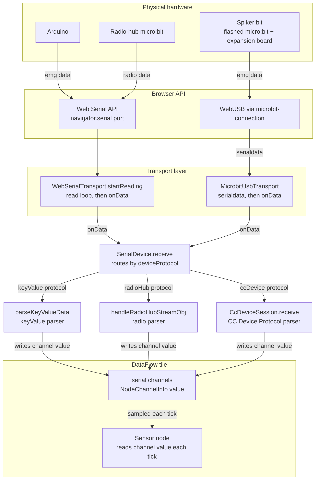
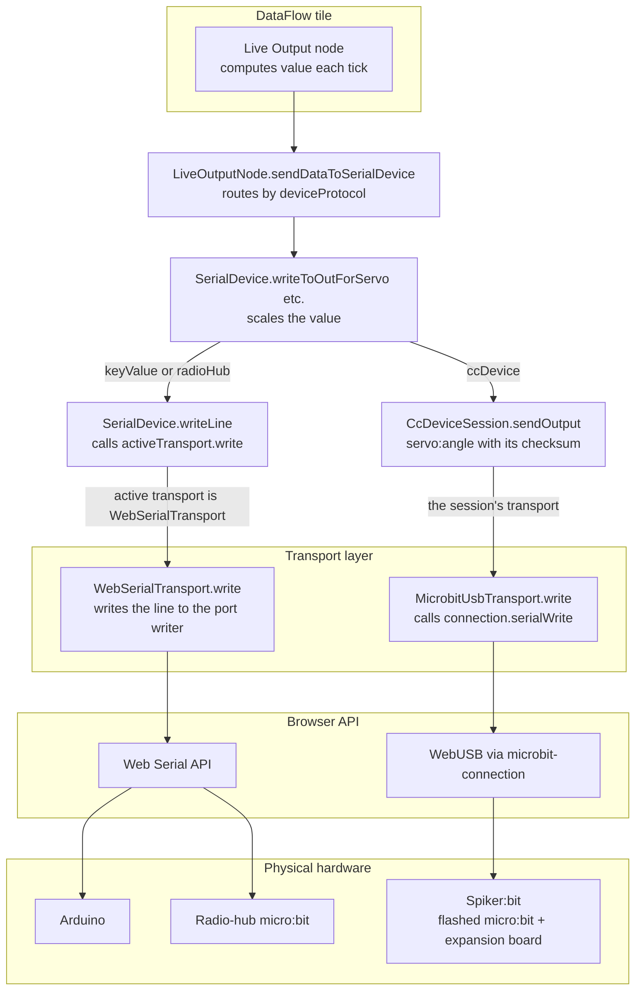

# Serial connections to DataFlow

How serial data moves between physical hardware and DataFlow tile nodes, for the two
current hardware paths:

- **Arduino** (and the radio-hub micro:bit) over the **Web Serial API**.
- **Spiker:bit** (a micro:bit expansion board) over **WebUSB**, via
  `@microbit/microbit-connection`.

Two directions are covered: **inbound** (bytes arriving at the computer → a Sensor node)
and **outbound** (a Live Output node → bytes leaving the computer).

> The diagrams below are shown as pre-rendered SVGs (so they display in any Markdown
> viewer); the editable Mermaid source for each is kept in a collapsed **Mermaid source**
> block underneath. If you edit the Mermaid, re-export the matching SVG into
> `images/` (from the repo root):
>
> ```
> PUPPETEER_EXECUTABLE_PATH="/Applications/Google Chrome.app/Contents/MacOS/Google Chrome" \
>   npx -y @mermaid-js/mermaid-cli \
>   -i src/plugins/dataflow/docs/serial.md \
>   -o src/plugins/dataflow/docs/images/dataflow-hardware.svg
> ```
>
> It writes one SVG per Mermaid block in document order (`…-1.svg` = inbound,
> `…-2.svg` = outbound); rename them to match the `![…]` references below.

## The objects

| Object | File | Role |
|---|---|---|
| `WebSerialTransport` | `src/models/stores/web-serial-transport.ts` | Owns the Web Serial port + read loop; `write()` out, `onData` in. `open(port?, options?)` resolves `"opened"`, `"canceled"`, `"failed"`, `"timeout"` or `"stillOpening"`, and skips the chooser when given a port. `lastPort` survives `close()`. |
| `MicrobitUsbTransport` | `src/models/stores/spikerbit-device.ts` | `IDeviceTransport` over a micro:bit WebUSB connection: `write()` out, `serialdata` → `onData` in, `status` → `onDisconnect("lost")`, and `navigator.usb`'s `disconnect` for its device → `onDisconnect("unplugged")`. |
| `SpikerbitDevice` | `src/models/stores/spikerbit-device.ts` | Spiker:bit connect, reset, firmware check and flash; taps `onData` for connect-time firmware detection, then hands the transport to the store. |
| `SerialDevice` | `src/models/stores/serial.ts` | Transport-agnostic connection store: holds the active transport and the registered channel sources, routes writes (`writeLine`) and inbound parsing (`receive`). `isConnected()` is observable. Keeps `lastLoss`. |
| `DeviceConnection` | `src/plugins/dataflow/model/device-connection.ts` | App-wide connect, reconnect and disconnect; one instance per `SerialDevice`, from `getDeviceConnection`. Tracks `lastChoice`, `busyChoice` and `connectTutorialDismissal`. Follows the latest `ConnectionAttempt` and exposes `attempt`, `lastFailure`, `paneView`, `actionsEnabled` and `dataReceived`; `currentFailure` drops a stall's failure once its device is no longer open (`holdsDevice`). Keeps the "Is it alive?" check, and exposes `lossReason`, `lossMessage` and `notResponding`. Holds the Connection help drawer's state (`help`, set by `openHelp` and cleared by `closeHelp`), whose notices follow `currentProblem`. |
| `ConnectionAttempt` | `src/plugins/dataflow/model/connection-attempt.ts` | One Connect or Reconnect: its step, step times, view, outcome and failure. See [The connection attempt](#the-connection-attempt). |
| tile device actions | `src/plugins/dataflow/utilities/device-actions.ts` | Wrap `DeviceConnection` for one tile: they reset the clicking tile's program, log the change, and record a failed attempt's message on the tile. |
| `parseKeyValueData` | `src/models/stores/serial-protocol.ts` | `keyValue` parser (Arduino): `emg:<n>\r\n` lines → channel values. |
| `CcDeviceSession` | `src/models/stores/cc-device-session.ts` | One CC Device Protocol session (Spiker:bit): opens it, pings it, parses its lines into channel values, and writes its outputs. Exposes `notResponding` and `identify()`. Created by `setActiveDevice` for a `ccDevice` device. |
| tile serial channels | `NodeChannelInfo[]` (`.../model/utilities/channel.ts`) | The shared blackboard: parsers write `channel.value`; the Sensor node reads it. Each mounted, editable tile registers its channels with `SerialDevice` as a channel source. |
| `SensorNode` / `LiveOutputNode` | `.../nodes/sensor-node.ts`, `live-output-node.ts` | DataFlow nodes that read inbound values / emit outbound values each tick. |

`IDeviceTransport` (`src/models/stores/device-transport.ts`) is the shared contract:
`write(line)`, `close()`, and optional `onData(chunk)` / `onDisconnect(loss)`.

Device **identity** (`SerialDevice.deviceFamily`: `arduino` / `microbit` / `spikerbit`)
is distinct from a channel's **protocol** tag (`channel.protocol`: `keyValue` /
`radioHub`). `kDeviceCapabilities` (`.../model/utilities/device-capabilities.ts`) maps
identity → `{ protocol, displayName, outputs, channels? }`: the Arduino speaks `keyValue`,
the radio-hub micro:bit `radioHub`, and the Spiker:bit `ccDevice` (the CC Device Protocol;
see [cc-device-protocol.md](cc-device-protocol.md)). A device with a `channels` list provides
only those channel ids, whatever their tag: the Spiker:bit lists `emg`, so it provides the
`emg` channel, which is tagged `keyValue`.

## Connecting a device

The connection is app-wide: there is one `DeviceConnection` per `SerialDevice` (from
`getDeviceConnection`), and it does not live in any tile component. At most one device is
connected at a time, and a second attempt while one is in progress is ignored (`busyChoice`).
It is started from the `connect` button in the DataFlow tile toolbar
(`components/toolbar/dataflow-connect-button.tsx`), or, in a unit whose own `tools` list leaves
out `connect`, from the older connect menu at the top of the tile. Both call the tile device
actions below. The log events name the device by the choice the user connected with
(`lastChoice`, such as `microbitHub`), not by the detected `deviceFamily`.

`DeviceConnection` provides `connect(choice, options?)`, `reconnect(options?)` and
`disconnect()`. Connect and reconnect resolve the attempt's outcome: `"connected"`,
`"canceled"`, a failure kind (`connect-failures.ts`), or `"unplugged"` / `"lost"` (see
[The connection attempt](#the-connection-attempt)). `options` carries an `attemptId` and a
listener. When a device is already connected, both disconnect it first. A Web Serial board and
the Spiker:bit take different flows, and both end by calling
`SerialDevice.setActiveDevice(deviceFamily, transport)`, which records the active transport,
wires its inbound callbacks, and marks the store connected. Inbound data is matched against the
registered channel sources (see [Channel sources](#channel-sources)).

**Web Serial (Arduino and radio-hub micro:bit):**

1. `new WebSerialTransport()`, then `transport.open()`:
   `navigator.serial.requestPort()` shows the browser's device chooser; on selection we
   read `getInfo()`, resolve `deviceFamily`, and open the port at 9600 baud.
2. `setActiveDevice(transport.deviceFamily, transport)` and
   `setRaisesWebSerialConnect(transport.raisesWebSerialConnect)`.
3. `transport.startReading()` starts the inbound read loop.

`WebSerialTransport.close()` cancels and releases the read loop's reader before it closes
the port, so the port can be opened again.

The device chooser is intentionally **unfiltered**. `requestPort()` could take USB-ID
filters so only Arduino-like boards appear, but working Arduino clones do not all match a
clean filter — one is shipped with the latest generation of Backyard Brains hardware — so
filtering would hide boards that actually work. Rather than chase every non-standard
board's IDs, we show everything and rely on `deviceFamily` resolution afterward. (A future
improvement would be to import an updatable, comprehensive board list and build filters
from it.)

**Device identity** is resolved from the USB descriptor in
`WebSerialTransport.determineDeviceFamily`: a micro:bit reports `usbProductId === 516 &&
usbVendorId === 3368`; anything else is assumed to be an Arduino. We've only seen authentic
Arduinos raise the Web Serial `connect` event. We check for that `usbProductId` (67), and only
drive the top-bar menu's physical-connection UI with it when we think we are getting this
`connect` event.

**Spiker:bit:** each Connect disconnects any earlier `SpikerbitDevice` and constructs a new
one with a new `@microbit/microbit-connection` USB connection, so the browser's chooser
shows every time. `connectAndStream` connects over WebUSB, resets the board with `!!`, checks
and if needed flashes the firmware (see
[Spiker:bit version check and flashing](#spikerbit-version-check-and-flashing) below), then
calls `setActiveDevice("spikerbit", transport)`. If any step fails after the link opens,
`connectAndStream` disconnects the library connection before it rethrows, so a failed attempt
doesn't leave the board open. If `disconnect()` is called while `connectAndStream` is still
running, for example during a stalled update, it stops at its next step with a `closed` error
instead of writing to the board or making it active, and it doesn't close the link, so an
abandoned connect can't disturb a newer one on the same board. Between the open and becoming
active, a loss of the board is reported to the connect's observer (`onLost`); a disconnect asked
for isn't one.

**Reconnect.** `reconnect()` repeats the last device choice, so the user doesn't pick a
device type again. For a Web Serial board it tries the last port
(`WebSerialTransport.lastPort`, which survives `close()`) first, and if that fails it shows
the browser's chooser. If the last port is still stuck opening (`"timeout"` or
`"stillOpening"`), the attempt ends as `openTimeout` instead, since choosing that port again would
get the same answer. A Web Serial unplug is noticed quickly, by the browser's `disconnect`
event or by the read loop giving up, and either one clears the active device. So Reconnect
isn't offered for an unplugged board: the pane shows the device choices, and Connect shows
the chooser. For a Spiker:bit it runs `connectAndStream` again on the known
`SpikerbitDevice`, whose library connection remembers the board and reopens it without the
chooser. If that board can't be opened (`openFailed`), for example because it was unplugged and
plugged back in, it disconnects that device and falls back to a new one, which shows the chooser.
Any other failure ends the attempt. A Spiker:bit
unplug is noticed by `navigator.usb`'s `disconnect` event, or else by the next write to the board
failing (see "Why a device went away").

**Disconnect** first ends an attempt still running as `canceled`, and disposes a Spiker:bit
that isn't active yet: one whose update stalled, or one the running attempt opened (see below).
It clears `lastFailure`, since a stall's failure goes with its device. It ends any CC Device
Protocol session (`SerialDevice.endSession`, waiting at most 500 ms, `kEndSessionTimeoutMs`),
then closes the transport and clears the active device. For a Spiker:bit, closing the transport
disconnects the library connection; the device is kept for Reconnect.

**Tile device actions.** The pane, the top-bar menu and the `reset` button call the tile device
actions in `device-actions.ts`, which wrap `DeviceConnection` and log `DATAFLOW_TOOL_CHANGE`
events with the operations `connectDevice`, `reconnectDevice`, `connectProgress`, `connectResult`,
`connectRecovered`, `abandonedOpen`, `deviceLost`, `disconnectDevice` and `resetProgram`. A
connect or reconnect resets only the clicking tile's program, through `resetProgramForTile`,
which says what Reset leaves alone, as soon as the device becomes the active one. Disconnect never
resets, and it also works while a stalled Spiker:bit update holds a board open that isn't active.

**Log events.** Each is a `DATAFLOW_TOOL_CHANGE` event for one tile (`tileId`): the clicking
tile; for the connect tutorial's events, the tile it covers; and for the Connection help's, the
tile it was opened from, even after that tile is deleted. The fields below sit at the top
level of the event. Every event of one attempt carries the same `attemptId`, and the device events
carry `targetType: "device"` and `device`: the choice id (`arduino`, `microbitHub` or
`spikerbit`). Step times are `attempt.steps`: ms from the click, for the steps that happened.

| `operation` | Other fields | Logged when |
|---|---|---|
| `connectDevice` | `attemptId` | Connect is clicked |
| `reconnectDevice` | `attemptId` | Reconnect is clicked |
| `connectProgress` | `attemptId`, `trigger`, `elapsedMs`, `step`, `steps`, `updatePercent` during an update | The attempt is still running 5, 10, 20, 40... s after the click |
| `connectResult` | `attemptId`, `trigger`, `outcome`, `elapsedMs`, `steps`; for a failure `failedStep` and `error` (`name`, `code`, `message`); for a Spiker:bit `firmware` (`found`, `updated`) | The attempt ends, including `canceled` |
| `connectRecovered` | `attemptId`, `elapsedMs`, `steps` | An attempt that ended in a stall gets its first data after all |
| `abandonedOpen` | `attemptId`, and what the `close()`, `forget()` and late settle of the abandoned open did | An open the attempt gave up on settles, or its best-effort close finishes |
| `deviceLost` | `attemptId`, `reason`: `unplugged`, `lost`, or `updateFailed` for a stalled update whose flash fails later | A device the attempt left open is lost, or a stalled update's flash fails later |
| `disconnectDevice` | `targetType: "device"`, `device`: the choice that was connected | The user disconnects |
| `resetProgram` | `targetType: "program"`, `trigger`: `connect`, `reconnect` or `button` | The program is reset |
| `showConnectTutorial` | `targetType: "connectTutorial"` | The connect tutorial appears over the tile |
| `dismissConnectTutorial` | `targetType: "connectTutorial"`, `trigger`: `ok` (OK in this tile), `okInAnotherTile` or `connection` | The tutorial over the tile is dismissed |
| `showConnectHelp` | `targetType: "connectHelp"`, `kind` | More… opens the Connection help |
| `hideConnectHelp` | `targetType: "connectHelp"`, `kind`, `trigger`: `close` (✕ or Escape) or `closeHelp` (the working notice's button) | The Connection help closes |
| `connectHelpNotice` | `targetType: "connectHelp"`, `notice`: `working`, `updating`, `differentProblem`, `unplugged` or `notConnected`; `kind` for `differentProblem`; `action`: `shown` or `clicked` | A notice appears in the Connection help, or the student clicks its button |

- `connectDevice` and `reconnectDevice` mark the click, not a success. A quick attempt logs
  `connectDevice`, `resetProgram` (when the device becomes active) and `connectResult`; anything
  the student did in between sits between them in time order. A slow attempt adds `connectProgress`
  events. A reload or a closed tab leaves a start, maybe some progress events and no result.
- A failed, stalled or `canceled` attempt logs its `connectResult` too, with no `resetProgram`
  unless the device became active first.
- Only a Disconnect the user chooses logs `disconnectDevice`. An unplug logs `deviceLost` when the
  attempt had ended with the device open; one before that ends the attempt, which `connectResult`
  records as `unplugged` or `lost`.
- A tile deleted during an attempt is left alone, but the attempt's events are still logged under
  its id.
- One OK or one connection dismisses the tutorial on every tile, so each tile it covered logs a
  dismissal; the tile whose OK was clicked has `trigger` `ok`. A tile that closes while the
  tutorial shows, such as a deleted tile, logs no dismissal.

### The connection attempt

Each Connect or Reconnect is a `ConnectionAttempt` (`model/connection-attempt.ts`), which
`DeviceConnection` drives and exposes as `attempt`. It starts at the click and ends with one
outcome, at the moment the promise from `connect` or `reconnect` resolves. `busyChoice` is set
until then.

| Step | Applies to | Ends when | Limit |
|---|---|---|---|
| `choose` | Connect, and a Reconnect that falls back to the chooser | The device chooser closes | None. Dismissing it ends the attempt as `canceled`. |
| `open` | All | The port or USB device is open | `kOpenTimeoutMs` (20 s), then `openTimeout` |
| `checkFirmware` | Spiker:bit | The firmware answers, or 1.5 s passes | Already bounded |
| `update` | Spiker:bit with old or missing firmware | The flash finishes and the re-query is done | `kUpdateStartMs` (45 s) to the first progress, then `kUpdateStallMs` (20 s) between progress reports, then `updateStalled` |
| `waitForData` | All | The first data arrives | `kFirstDataTimeoutMs` (5 s) from when the device became active, then `notResponding` (Spiker:bit) or `noData` |

`attempt.steps` records when each step happened, in ms from the click: `chooserClosed`, `opened`,
`firmwareChecked`, `updateStarted`, `updateFinished`, `active` (when `setActiveDevice` ran) and
`firstData`. For a Spiker:bit, `attempt.firmware` records the firmware it answered with and
whether it was updated. The open limit lives in the transports (`WebSerialTransport.open`'s
`timeoutMs`, `SpikerbitDevice`'s `openTimeoutMs`); the other two are timers in
`DeviceConnection`, cleared when the attempt ends or a new one starts, and as soon as a flash
fails, so a slow close after it can't be taken for a stall. The library's `connect()` shows the
Spiker:bit's chooser itself. It reports a `"FindingDevice"` progress stage before the chooser and
`"Connecting"` once a device is chosen, or at once for a board it knows. `SpikerbitDevice` starts
its limit at `"Connecting"` and reports it as `onOpening`, which records `chooserClosed` when the
chooser was shown, so the time in the chooser never counts.

Other failures: Web Serial's `"failed"` is `openFailed`. A Spiker:bit's `device-in-use` is
`inUse`, the library's own 10 s limit on the USB open (code `timeout`) is `openTimeout`, any
other error before the open is `openFailed`, and an error after the open but before the board is
active is `updateFailed`, which disposes the device. A loss of the device before the first data,
active or not, ends the attempt as `unplugged` or `lost` at once. A Disconnect while the attempt
runs ends it as `canceled`, so no failure is recorded. `lastFailure` holds the latest attempt's
failure, with its step and how long that step had run.

**The two views.** The connect pane shows either the device list or the connected actions, and
`paneView` says which. While an attempt runs it is the attempt's own view, not `isConnected`:

- A Connect starts on the device list and switches to the actions when the device opens. For a
  Spiker:bit that is the USB open, before the firmware check.
- A Reconnect keeps the actions throughout, and goes back to the device list only if it fails
  before the open.
- `actionsEnabled` is false from the open until the first data arrives or a stall ends the
  attempt, and again while a stalled update is making progress (`updateResumed`).
- Any failure at or before the open, `updateFailed`, a loss or a cancel leaves the device list.

**Stalls and recovery.** `updateStalled`, `noData` and `notResponding` end the attempt, but the
device stays open and the stalled step keeps running. The actions are enabled, and a stalled
update keeps the actions view though its board isn't active yet. A stall's failure counts only
while its device is open (`holdsDevice`): the button and the pane ignore one that outlasted it.

- **Progress from a stalled update** clears `lastFailure` and calls `onStallChanged` with no
  failure. `updateResumed` is then true: the pane shows the ended attempt's update and progress
  bar as if it still ran, the help's notice is `updating`, and the actions are disabled. Another
  `kUpdateStallMs` without progress sets `lastFailure` to `updateStalled` again, through
  `onStallChanged`.
- **An update that finishes after all** makes the board active without a second outcome. It no
  longer stalls, so `lastFailure` is cleared, and the board gets the same 5 s wait for its first
  data. If none comes, `lastFailure` becomes `notResponding`. The listener hears both changes
  through `onStallChanged`, and the tile device actions show them on the tile.
- **First data after a stall** sets `attempt.recovered`, clears `lastFailure` and calls the
  listener's `onRecovered`.
- **Disconnect or Connect during a stalled update** first disposes that `SpikerbitDevice`, which
  closes its library connection and so stops the flash. Reconnect closes the library connection
  too, but keeps the device and reopens it without the chooser.
- **A loss after the attempt has ended** with its device open calls the listener's `onLost` and
  clears `lastFailure`, so the pane shows the loss rather than the stall. That includes a stalled
  update's board, which isn't active yet: its loss is also recorded on `SerialDevice.lastLoss`
  (`recordLoss`), so the pane shows it.
- **A stalled update whose flash fails after all** disposes the board, and `lastFailure` becomes
  `updateFailed`. The listener hears it as `onLost` with the reason `updateFailed`, and the tile
  shows that failure.

**Giving up on an open.** Neither Web Serial nor WebUSB is known to let a page close a device
while its open is pending, so at the limit the attempt stops waiting: it ends as `openTimeout`
right away, and the Connect buttons are enabled again. In the background the transport tries
`close()` and `forget()` on the stuck port or device, and closes it if the abandoned open
succeeds later. Neither is awaited, since a stuck device may not close either. Each reports what
happened through the listener's `onAbandonedOpen`. A retry while the browser still has the old
open pending is refused at once with an `InvalidStateError`, which `WebSerialTransport` resolves
as `"stillOpening"`; that is `openTimeout` too. Unplugging the device is what reliably ends a
pending open.

### Channel sources

Each DataFlow tile owns its own `NodeChannelInfo[]`. While a tile is mounted and editable,
`DataflowProgram` registers a channel source,
`SerialDevice.registerChannelSource(() => this.props.tileContent.channels)`, which reads the
tile's current channels on each call, since `setChannels` replaces the array. It returns a
disposer that `DataflowProgram` calls on unmount. `SerialDevice.receive` parses inbound data
against the flattened channels of every registered source, and every channel with a
matching id updates, so several tiles can read the same device at once.

## Spiker:bit version check and flashing

The Spiker:bit runs a fixed micro:bit program, bundled at
`src/plugins/dataflow/firmware/spikerbit-clue.hex`. Before handing the transport to the
store, `SpikerbitDevice.connectAndStream` makes sure the board is running a current build:

1. It points the transport's `onData` at a connect-time handler (`handleFirmwareData`) that
   scans inbound data with `detectFirmwareReply`, recording the reply. A reply is either a
   CC Device Protocol `hello` line with a valid checksum, or the legacy `CLUE-SPIKERBIT v<N>`
   banner that older firmware sends. Stale readings, empty lines and `ok` lines before the
   reply, and a reply split across chunks, are handled; a `hello` with a missing or bad
   checksum is ignored.
2. `queryFirmware` writes `!! #n` and a bare `?` in one write, so that the `hello` starts a
   line of its own after any backlog of old output (see
   [Connecting](cc-device-protocol.md#connecting)). The `ok` to the `!!` needs no handling: a
   valid `hello` identifies the firmware whether or not an `ok` came first, so a `hello` with no
   `ok` before it is accepted too, and firmware v1–v3 answers with its banner.
3. If nothing is identified 200 ms (`kRetryAfterDrainMs`) after the backlog has drained, the
   replies may have been dropped while DAPLink's buffer was still full, so `queryFirmware`
   writes `!!` and `?` once more. Each `serialdata` event carries one DAPLink read, at most 62
   bytes (`kDaplinkReadBytes`), and a backlog drains in full reads, so the first shorter read
   counts as drained. That is only a hint: 100 ms with no data (`kDrainQuietMs`) counts too. If
   nothing is identified within 1.5 s (`kFirmwareQueryTimeoutMs`) in all, there is no reply.
4. The connect-time `!!` counts from 1000, above the 1 to 999 that `CcDeviceSession` uses. A
   late reply to it can reach the session, such as the reply to the first write after the retry
   has identified the board. Its `#n` can't be taken for the `ok` to the session's `open` or a
   `ping`.
5. `shouldFlash` decides. It flashes the bundled hex (a partial flash, reporting progress)
   and queries again when there is no recognized reply, the reply is a legacy banner, the
   `hello` names a protocol or protocol version Dataflow doesn't speak or another device (even
   if its firmware is newer), or its firmware is older than `kSpikerbitFirmwareVersion`. It
   connects without flashing when the `hello` names `CCDeviceProtocol` version 1 and
   `device:spikerbit`, and the firmware is the same or newer. The USB connection stays Connected across the flash: the DAPLink interface chip
   is untouched and serial auto-reinitializes, so no explicit reconnect is needed. The
   re-query after the flash uses the same steps and the same rule, and only warns.
6. It then calls `setActiveDevice("spikerbit", transport)`, which repoints
   `onData` from firmware detection to `SerialDevice.receive` and starts a CC Device
   Protocol session. The board streams EMG readings once it acknowledges the session's
   `open`.

Keep `kSpikerbitFirmwareVersion` equal to the `firmware:` number in the `HELLO` line of
`spikerbit-clue.ts`, and bump both whenever the firmware's behavior changes; see
[the firmware README](../firmware/README.md) for how to rebuild the hex.

## The CC Device Protocol session

`SerialDevice.setActiveDevice` starts a `CcDeviceSession` for a device whose protocol is
`ccDevice`. The session speaks the [CC Device Protocol](cc-device-protocol.md):

1. It sends `open session:<id> #n` with a random id, and re-sends it every 2 s until an
   `ok` arrives.
2. It then sends `ping session:<id> #n` every second, which keeps the session open on the board.
   The replies feed the not-responding count (below).
3. When a pending ping gets `err nosession`, it opens a new session with a new id. Chrome slows
   timers in hidden tabs, so this is how a session that lapsed while its tab was hidden
   recovers. When one gets `err othersession`, it stops, since another host owns the session, and
   counts as not responding (below). A `nosession` or `othersession` that answers anything else,
   such as a ping from before a re-open, changes nothing.
4. Disconnecting sends `close session:<id>` (`SerialDevice.endSession`), also while an `open`
   is still waiting for its `ok`, so the board shows the waiting icon at once instead of after
   the timeout.

Its `#n` counts from 1 to 999 and wraps to 1 (see
[Spiker:bit version check and flashing](#spikerbit-version-check-and-flashing)). Every line
Dataflow sends has a checksum, except the connect-time `?`.

An `open` re-sent because its `ok` was late, not lost, reaches a board that has already started
the session, and the board starts it afresh, with its settings back to their defaults. There are
no settings yet; once there are, they should be sent only after every pending `open` is
answered.

**Not responding.** The session counts the `open`s and `ping`s it has sent since the last reply
to one of them. When a fourth would go out with three still unanswered, about 3–4 s after the
last reply (about 6 s while still opening), it sets the observable `notResponding`. A reply to
one of them (`ok`, or any `err` but `othersession`) clears it and restarts the count.
`err othersession` sets it until the next connect or reconnect. The count is in commands, not
seconds. It pauses while the page is hidden and restarts when it's visible: in a hidden tab the
browser slows the transport's reads below the rate the readings arrive, so replies fall behind
and would look missing.

**Identify.** `identify()` sends `identify #n` and resolves `"answered"` on any reply carrying
that `#n`, `ok` or `err`, or `"noAnswer"` after 2 s. It works whatever state the session is in,
and its reply doesn't count as an answer to the session's commands.

A Live Output servo node sends `servo:<angle>` on every tick, without `#n`. Each reading
updates every channel whose `channelId` is the reading's name, in every registered tile, and
stamps its `lastMessageReceivedAt`. `ok` and `err` drive the session; `hello` and lines it
doesn't recognize are ignored.

## Inbound: hardware → Sensor node



<details>
<summary>Mermaid source</summary>



</details>

Walkthrough:

- **Arduino (Web Serial):** the physical device emits `emg:<n>\r\n`. `WebSerialTransport`'s
  read loop decodes each chunk and calls `onData`, which `SerialDevice.setActiveDevice`
  wired to `SerialDevice.receive`. `receive` looks up the device's protocol in the
  capability map and dispatches to `handleKeyValueStreamObj` → `parseKeyValueData`,
  which writes `channel.value` on every matching channel.
- **Spiker:bit (WebUSB):** `MicrobitUsbTransport` owns the connection's `serialdata` event
  and forwards each chunk to `onData`, which `SerialDevice.setActiveDevice` wired to
  `SerialDevice.receive` — exactly like the Web Serial path. The Spiker:bit's `deviceFamily`
  maps to the `ccDevice` protocol, so `receive` hands the chunk to the active
  `CcDeviceSession`, which drops lines with a missing or wrong checksum, handles `ok` and
  `err` itself, and writes each reading to the channels with its name. During connect (before
  `setActiveDevice`), `SpikerbitDevice` temporarily points `onData` at a firmware-detection
  handler to decide whether to flash; EMG parsing begins once the transport becomes the
  active device.
- **Into the node:** both paths mutate the same `NodeChannelInfo` objects (each registered
  tile's `channels`). Each tick the Rete manager samples them and the `Sensor node`'s
  `data()` reads `getChannels().find(...).value`.

> **micro:bit vs. Spiker:bit.** Both are physically micro:bits, but they connect
> differently. A **radio-hub micro:bit** connects over **Web Serial** (same transport as
> the Arduino); `receive` routes its data to `handleRadioHubStreamObj` — a different parser
> — because its `deviceFamily` maps to the `radioHub` protocol. The **Spiker:bit** is a
> micro:bit running the flashed `spikerbit-clue.hex` program on an expansion board; it
> connects over **WebUSB** so it can be flashed and read via `@microbit/microbit-connection`.

### Reconstituting messages from the stream

The read loop hands each parser a raw string chunk decoded from the port. A chunk is a
malformed representation of any number of whole or partial serial messages, chomped off
the stream at unpredictable spots that do not respect the original message boundaries. So
the parser cannot assume a chunk is one clean line. Each parser therefore appends the chunk to
a **local buffer** and leaves any trailing partial line there for the next chunk.
`parseKeyValueData` and `handleRadioHubStreamObj` scan the buffer for a complete, legitimate
value using a regular expression closely paired to the devices and the sensors/actuators
DataFlow supports. On a match they parse out the value plus an indicator of which channel the
value belongs to, find that channel, and set the value on it. `CcDeviceSession.receive` instead
splits whole lines off its buffer (`splitLines`) and parses each with `parseCcDeviceLine`.

## Outbound: Live Output node → hardware



<details>
<summary>Mermaid source</summary>



</details>

Walkthrough:

- Each tick, the `Live Output node`'s `data()` calls `sendDataToSerialDevice`, which reads
  `serialDevice.deviceFamily`, resolves its protocol via the capability map, and calls the
  matching `SerialDevice.writeToOut…` formatter (e.g. servo-angle scaling).
- For `keyValue` and `radioHub`, the formatter produces a line string and calls
  `SerialDevice.writeLine(line)`: `this.activeTransport.write(line)`.
- For `ccDevice` (the Spiker:bit), `writeToOutForServo` hands the rounded angle to the
  active `CcDeviceSession`, which writes `servo:<angle>*hh` through the transport it was
  given by `setActiveDevice`, the same one `writeLine` would use. The session writes its own
  `open`, `ping` and `close` the same way.
- Only the concrete transport differs: `WebSerialTransport.write` frames the line and
  writes it to the Web Serial port's writer; `MicrobitUsbTransport.write` calls
  `connection.serialWrite`. Neither the node nor `SerialDevice` knows or cares which
  transport is active.

## Connection status tracking

The UI reflects connection state through `SerialDevice.isConnected()`, which is observable, so
it re-renders as the connection changes. For the top-bar menu, `SerialDevice` also keeps
`connectChangeStamp`/`lastConnectMessage` (the last time and reason the status changed, updated
via `updateConnectionInfo`).

Whether a program needs a device is per tile. Each DataFlow tile's `content.needsDevice` is a
volatile value that its `ReteManager` keeps current as the student edits
(`updateNeedsDevice`, using `programNeedsDevice` in
`src/plugins/dataflow/utilities/program-needs-device.ts`). When a tile's program needs a
device and none is connected as the program opens, the tile shows the connect tutorial
(`components/ui/dataflow-connect-tutorial.tsx`). That is checked only when the program opens
(`ReteManager.recordNeedsDeviceOnOpen()`), never after an edit or a connection change.

The browser's own `navigator.serial` `connect`/`disconnect` events are wired once at store
creation by `initWebSerialConnectionEvents` (`web-serial-transport.ts`), keeping
`navigator.serial` out of `SerialDevice`. Authentic Arduinos raise `connect` before the user
clicks, so the top-bar menu can note a board is present. The `disconnect` handler acts only on
the port of a `WebSerialTransport`. It records an unplug of the active one, or upgrades a loss
already recorded for it, so another device's unplug, serial or WebUSB, changes nothing.

### Why a device went away

A device that goes away without the user asking is recorded on `SerialDevice.lastLoss`
(observable), with a reason: `"unplugged"` when the browser reported the device removed, `"lost"`
for anything else. Transports report it through `onDisconnect(loss)`, which `setActiveDevice`
wires to `recordUnplug` for `"unplugged"` and to `clearActiveDevice(loss)` for `"lost"`:

| Transport | `"unplugged"` | `"lost"` |
|---|---|---|
| Web Serial | `navigator.serial`'s `disconnect` event for the device's port, from `initWebSerialConnectionEvents`. Authentic Arduinos raise it, and so did the two clone Arduinos tried; the radio hub hasn't been tried. | the read loop giving up on a port that stopped being readable, a few seconds later |
| WebUSB (Spiker:bit) | `navigator.usb`'s `disconnect` event for the library connection's device, which `MicrobitUsbTransport` listens for itself. It then closes the library connection, whose status would otherwise stay Connected. | the library's `Disconnected` status, which follows any failed WebUSB call (see below) |

An unplug can be reported by both paths, in either order. The second finds the device already
cleared, so the guard in `onDisconnect` ignores a second `"lost"`, and `recordUnplug` turns a
`"lost"` already recorded for the same transport into `"unplugged"`, keeping its time.
`DeviceConnection.disconnect` unhooks the transport's `onDisconnect` before closing it, because a
requested close also raises the library's `Disconnected`. A connect attempt clears the record.

`DeviceConnection` turns this into `lossReason`, which the connect pane shows ("It was unplugged."
or "Connection lost."), `lossMessage` for the connect button's tooltip ("The Spiker:bit was
unplugged." or "The connection to the Spiker:bit was lost."), and `lossAt` (a new value pulses
the connect button three times).

`MicrobitUsbTransport` listens for `navigator.usb`'s `disconnect` itself, since CLUE doesn't call
the library's `initialize()`, where the library would. Without that event, an unplug would be
noticed only when a write fails: the session's `ping` every second, a re-sent `open`, or a servo
command. After `err othersession` the session stops pinging, so the event is then the only way
it's noticed unless a program is writing to the servo.

While connected, `DeviceConnection` also exposes `notResponding` and `canIdentify` from the
session. `identify()` runs the "Is it alive?" check, and `check` reports it: `"checking"`, then
the answer for 3 s. The check remembers the `CcDeviceSession` it asked and counts only while that
object is active, so it survives the pane closing and never shows an earlier board's answer.

A Spiker:bit connect that fails because another tab or app has claimed the board (the library's
`device-in-use` error) returns `"inUse"`, which the pane reports as "In use by another tab."

## Summary

Both directions run through `SerialDevice` and are transport-agnostic: outbound via
`writeLine → activeTransport.write` (or the `CcDeviceSession`, which writes to the same
transport), inbound via `transport.onData → SerialDevice.receive`.
The active transport is swapped in at connect through `setActiveDevice`.
