# Spiker:bit firmware guide

What the Spiker:bit firmware does, how to talk to it, and what its micro:bit shows. It is for
anyone deciding whether to use or extend the firmware, or driving it from their own app.

## What it is

The firmware runs on a micro:bit plugged into a Backyard Brains Spiker:bit. It:

- reads the EMG (muscle) signal on P1, with P8 and P9 held low to put the Spiker:bit in EMG
  mode, and sends a smoothed envelope of it;
- drives a servo on P0;
- speaks a text protocol, the CC Device Protocol, over USB serial at 115200 baud, so every
  command can be typed by hand;
- is a universal hex, `spikerbit-clue.hex`, that runs on a micro:bit V1 or V2. The signal
  processing is tuned for a V2.

Dataflow flashes it automatically. When Dataflow connects to a micro:bit that isn't running
this firmware, or is running an older version, it writes the bundled hex to the board over
WebUSB and then connects.

## Getting it onto a board

Either:

- connect the board from a Dataflow tile, which flashes it as above; or
- plug the micro:bit into a computer and copy [`spikerbit-clue.hex`](spikerbit-clue.hex) to
  the `MICROBIT` drive that appears. The board restarts running the firmware and shows the
  waiting icon (see [LED displays](#led-displays)).

## Trying it by hand

Every command can be typed, so a serial terminal is the quickest way to try the firmware on a
board. [serialterminal.com](https://serialterminal.com) works well: it runs in Chrome or Edge
(it uses Web Serial), and it sends a whole line at a time, so typing mistakes can be fixed
before sending.

1. Close anything else using the board, such as a connected Dataflow tab. Only one program can
   have the port open.
2. Set the baud rate to **115200** and connect, picking the micro:bit in the browser's list.
3. Leave "send with /n" checked. The firmware ignores the `\r` that "send with \r" adds.
4. Type a command and press Enter. Checksums are optional when typing. A long `timeout` keeps
   the session open while you type, for example:

```
?
open session:7 timeout:30000 #1
servo:90
identify #2
close session:7 #3
```

`npm run bench:spikerbit` checks every command's reply automatically (see
[`scripts/spikerbit-bench/`](../../../../scripts/spikerbit-bench/)).

### Plotting readings in MakeCode

The MakeCode editor can plot the EMG readings, because each one is a `name:value` line. Its
plotter button only appears once the board sends data, and the board is silent until it's
spoken to, so start free-run first.

1. Close anything else using the board, as above.
2. Open any project at [makecode.microbit.org](https://makecode.microbit.org) (not the home
   page) and pair the board with **Connect device**. Don't download the project to the board:
   that replaces this firmware.
3. Long-press button A until the streaming icon shows.
4. Click **Show data Device** under the simulator (some MakeCode versions call it **Show console
   Device**). It appears within a second or two of the first reading.

Long-press button A again to stop the readings.

## Talking to it

- **One message per line.** End each line with `\n`. The board ends its lines with `\r\n`, and
  accepts either ending.
- **A line is a command, then its `name:value` assignments,** separated by spaces:
  `open session:7`. A line with no command sets outputs: `servo:90`.
- **`#n` asks for an acknowledgment.** End a command with `#` and a number, and the board
  replies `ok #n` once the command has been applied: `identify #2` gets `ok #2`. Without
  `#n` a command gets no `ok`. Errors are sent either way, as `err #n <reason>`, or
  `err <reason>` when the command had no `#n`. A well-formed `?` gets the `hello` line, and
  never an `ok`, even with `#n`.
- **`*hh` is an optional checksum** at the very end of a line. The board puts one on every line
  it sends. When sending, leave it off, or add it and the board checks it.

To compute a checksum, XOR the bytes of every character before the `*`, and write the result
as two hex digits (either case). For `emg:12`:

| Character | `e` | `m` | `g` | `:` | `1` | `2` |
| --- | --- | --- | --- | --- | --- | --- |
| Byte | `65` | `6D` | `67` | `3A` | `31` | `32` |
| Running XOR | `65` | `08` | `6F` | `55` | `64` | `56` |

So the board sends `emg:12*56`.

A session, with the checksums written out:

```
Dataflow:   ?
Spiker:bit: hello protocol:CCDeviceProtocol version:1 device:spikerbit firmware:4*65
Dataflow:   open session:4821 #1*4D
Spiker:bit: ok #1*36
Spiker:bit: emg:12*56
Dataflow:   ping session:4821 #2*4A
Spiker:bit: ok #2*35
Dataflow:   servo:90*4E
Dataflow:   close session:4821*1D
```

The board checks a whole line before applying any of it, so a line with an error changes
nothing.

## Commands

Any command but `?` can end in `#n`, which adds an `ok #n` to its reply. Any line can also get
`err unknown`, `err checksum` or `err value` for the reasons in [Errors](#errors).

| Command | What it does | Replies |
| --- | --- | --- |
| `?` | Identifies the board, in any state. In idle it also shows the found icon. | the `hello` line |
| `open session:<id> [timeout:<ms>]` | Starts a session with that id, from any state. An `open` during a session replaces it with a new one. `timeout` is how long the session lasts without a `ping`. | `ok #n`, or `err value` |
| `ping session:<id>` | Keeps the session with that id alive. | `ok #n`, or `err value`, `err nosession` or `err othersession` |
| `ping` | A liveness check, in any state. It touches no session. | `ok #n` (nothing without `#n`) |
| `close session:<id>` | Ends the session with that id at once. | `ok #n`, or `err value`, `err nosession` or `err othersession` |
| `identify` | Shows the identify icon and plays a short sound, in any state, to draw attention to the board. | `ok #n` |
| `servo:<angle>` | Sets the servo on P0, in any state. The angle is a number with an optional leading `-` and an optional fraction with digits on both sides of the `.` (`90`, `-5`, `45.5`); it is rounded and clamped to 0–180. | `ok #n`, or `err value` |
| `stream` | Starts free-run from idle. In free-run it changes nothing. | `ok #n`, or `err insession` |
| `stop` | Stops free-run, back to idle. In idle it changes nothing. | `ok #n`, or `err insession` |

The session id is a whole number the host picks, from 1 up to the largest id in
[Timing and limits](#timing-and-limits). The default `timeout`, and the range `open` accepts,
are there too. Only `open`, `ping` and `close` carry the session id. `servo` doesn't: a host
may send it on every tick, and only one host can hold the port.

**Readings:** `emg:<int>`, the smoothed EMG envelope, is sent in a session and in free-run, at
the interval in [Timing and limits](#timing-and-limits). The firmware tracks the signal's
resting baseline, takes how far each sample is from it, and smooths that, so the value is near 0
at rest and rises with muscle activity. Each reading is on its own line, so serial plotters plot
it. `ok` and `err` lines contain no `:`, so plotters skip them.

**The `hello` line** is `hello protocol:CCDeviceProtocol version:1 device:spikerbit firmware:4`:

- `protocol:CCDeviceProtocol` names the protocol.
- `version:1` is the protocol version. It changes only for a change that older hosts can't
  handle.
- `device:spikerbit` names the device.
- `firmware:4` is this firmware's build. It changes with every release, so a host can tell
  when a board's firmware is out of date.

## Errors

| Reason | Meaning | Sent for |
| --- | --- | --- |
| `checksum` | The line's `*hh` doesn't match its contents, or isn't two hex digits. Sent without `#n`, since the line's `#n` can't be trusted. | any line |
| `unknown` | A command the board doesn't know, or a `name:value` (or a bare word) the command doesn't take, such as `stream servo:90`. | any line |
| `value` | A value the board can't use. | `open` with a missing or out-of-range `session`, or a `timeout` that isn't a whole number in range; `close` with no `session`; `ping session:` or `close session:` with an id that isn't a whole number in range; `servo:` with a value that isn't a number in the form above (`+90`, `.5` and `90.` are not); and any line whose last token starts with `#` but isn't `#` and digits, or that doesn't fit in the receive buffer with its newline (see [Timing and limits](#timing-and-limits)), both sent without `#n` |
| `insession` | Not allowed during a session. | `stream`, `stop` |
| `nosession` | No session is running, for example because it timed out. The host must `open` again. | `ping session:<id>`, `close session:<id>` |
| `othersession` | A session with a different id is running. Nothing changes, so a stale or second host can't keep alive or close a session it doesn't own. | `ping session:<id>`, `close session:<id>` |

## States

| State | Entered by | Left by | What the board does |
| --- | --- | --- | --- |
| **Idle** | power-up; a session ending; `stop` or a long press in free-run | `open`, `stream` or a long press | Sends nothing unless spoken to. Answers commands. |
| **Session** | `open`, from any state | `close`, or no `ping` with its id for the session's timeout; both go to idle. Another `open` starts a new session. | Sends readings. |
| **Free-run** | `stream` or a long press, from idle | `stop` or a long press, to idle; `open`, to a session | Sends readings with no keepalive, for plotters and terminals. |

- **The board is silent until it is spoken to.** It sends no startup banner. The micro:bit's
  USB interface chip holds about 1 KB of output that nobody reads, so anything sent then would
  reach the next host as stale data.
- **When a session ends,** readings stop, the timeout returns to its default, any sound stops,
  and the display shows the waiting icon. The servo keeps its position.
- **Button A:** a long press (held about a second) switches between idle and free-run, like
  `stream` and `stop`. It does nothing during a session, and a click does nothing in any
  state, so a student pressing buttons during a Dataflow program changes nothing.

## LED displays

<!-- generated: displays -->
<!-- Generated from spikerbit-clue.ts by npm run build:firmware. Edit the comments there, not this section. -->
| Display | When it shows |
| --- | --- |
| <br>**Waiting** | Shown at power-up, when a session ends, and when free-run stops. The board is idle and no `?` has arrived since. |
| <br>**Found** | Shown after a `?` arrives while idle: a host has found the board but hasn't opened a session. If it stays, Dataflow's version check or flashing didn't finish. |
| <br>**Connected** | Shown for 3 seconds after `open` starts a session. The display is then cleared and stays blank for the rest of the session, unless an `identify` arrives. |
| <br>**Identify** | Shown for 3 seconds after `identify`, in any state, along with a short sound on a micro:bit V2. The display then goes back to what the state calls for. |
| <br>**Streaming** | Shown in free-run, which `stream` or a long press of button A starts. |
<!-- end generated: displays -->

## Timing and limits

<!-- generated: values -->
<!-- Generated from spikerbit-clue.ts by npm run build:firmware. Edit the comments there, not this section. -->
| Setting | Value |
| --- | --- |
| How often a reading is sent, in a session or in free-run. | 100 ms |
| How long a session lasts without a `ping`, when `open` doesn't give a `timeout`. | 5,000 ms |
| The shortest `timeout` that `open` accepts. | 1,000 ms |
| The longest `timeout` that `open` accepts. | 60,000 ms |
| The largest session id; ids start at 1. | 65,535 |
| How long the connected and identify icons show. | 3,000 ms |
| The serial receive buffer, in characters. A line that doesn't fit, with its newline, is thrown away and answered `err value`, without its `#n`. | 128 |
<!-- end generated: values -->

## Sound and pins

`identify` plays its sound on the micro:bit's built-in speaker only. The firmware turns off the
edge-pin audio output at startup, because the first sound would otherwise connect audio to P0
and make the servo twitch. A micro:bit V1 has no speaker, so it shows the identify icon without
a sound.

| Pin | Use |
| --- | --- |
| P0 | Servo signal out |
| P1 | EMG signal in (analog) |
| P8, P9 | Held low, to put the Spiker:bit's analog front end in EMG mode |
| Button A | A long press starts or stops free-run (see [States](#states)) |

Apart from the pins the LED display and buttons use, the firmware uses no other pins. The
[README](README.md#spikerbit-hardware-reference-pinout--power) lists the Spiker:bit's full
pinout, including the free P2.

## Driving it from your own app

Any program that can open the micro:bit's serial port at 115200 baud can drive the board. A
host does this:

1. **Send `?` and check the `hello` line:** `protocol:CCDeviceProtocol`, `version:1` and
   `device:spikerbit`. Send this `?` without a checksum: firmware older than version 4 answers
   only a bare `?`, with the v1–v3 banner, `CLUE-SPIKERBIT v<N>`.
2. **Send `open session:<id> #n` with a random id,** and send it again if no `ok #n` arrives.
3. **Send `ping session:<id> #n` every second,** well inside the default timeout in
   [Timing and limits](#timing-and-limits). The `ok` replies show the board is still there.
4. **Read the `emg:` readings.** Match `ok` and `err` replies by their `#n`, not by their
   position, and ignore lines you don't recognize.
5. **On `err nosession`, open a new session** with a new id. The session lapsed, for example
   because the browser slowed timers in a hidden tab.
6. **On `err othersession`, stop.** Another host owns the board.
7. **Send `servo:<angle>` whenever the output changes,** without `#n` if it is sent often.
8. **Send `close session:<id>` when done,** so the board goes idle and shows the waiting icon
   at once rather than after the timeout.

The reference implementation is Dataflow's `CcDeviceSession`, in
[`cc-device-session.ts`](../../../models/stores/cc-device-session.ts). Line parsing and
checksums are in [`cc-device-protocol.ts`](../../../models/stores/cc-device-protocol.ts).

## Going further

- [The CC Device Protocol](../docs/serial-protocols.md#cc-device-protocol): how the protocol
  is designed and how it is extended with new commands, outputs and settings.
- [`spikerbit-clue.ts`](spikerbit-clue.ts): the firmware source. Its header explains the
  signal processing and the rules the program follows.
- [`README.md`](README.md): building the hex, the CI checks, testing in Jest, and
  prototyping in MakeCode.
- [`scripts/spikerbit-bench/`](../../../../scripts/spikerbit-bench/): a script that checks a
  real board's reply to every command.
- [`spikerbit-firmware.test.ts`](../../../models/stores/spikerbit-sim/spikerbit-firmware.test.ts):
  the Jest tests that run the firmware on a simulated micro:bit.
